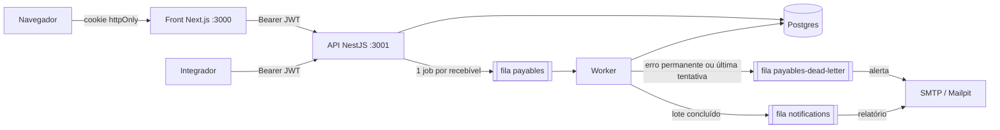

# Design Document

## Overview

O Aprova-me tem três partes: uma API NestJS, um worker que processa lotes e um front Next.js 16. A API e o worker são **o mesmo código** com dois pontos de entrada (`backend/src/main.ts` e `backend/src/worker.ts`). Assim o processamento de lotes escala separado das requisições, e um lote de 10.000 itens não deixa a API lenta.

Os requisitos estão em [requirements.md](requirements.md). Este documento explica as decisões que um agente precisa conhecer antes de mudar o código, e **por que** elas foram tomadas. Várias contrariam o enunciado de propósito; não "corrija" de volta.

| Enunciado | Escolha | Por quê |
| --- | --- | --- |
| SQLite | Postgres 17 | Escrita concorrente do worker; é o banco que a Bankme usa. |
| `value` float | `DECIMAL(15,2)`, texto no JSON | `0.1 + 0.2 !== 0.3`. Dinheiro nunca passa por `number`. |
| Token no `localStorage` | Cookie httpOnly | Um XSS não consegue ler o token. |
| Fila não especificada | BullMQ + Redis 7 | Retentativa com backoff, filas separadas, integração com Nest. |
| `assignor` int | UUID | O enunciado pede UUID nos ids; mesmo tipo nos dois lados da relação. |

## Architecture



Ambientes:

- **Local:** `docker-compose.yml` sobe Postgres, Redis, Mailpit (SMTP falso, caixa em `:8025`), API, worker e front. A imagem da API roda `prisma migrate deploy`, o seed e depois `node dist/main.js`. O worker usa a mesma imagem com `node dist/worker.js`.
- **AWS:** `infra/terraform` cria VPC, ALB, ECS Fargate (API, worker e front), RDS Postgres, ElastiCache Redis, Secrets Manager, ECR e o papel OIDC do GitHub. `.github/workflows/deploy.yml` publica depois do CI verde na `main`, só se `AWS_DEPLOY_ENABLED=true`.

## Components and Interfaces

### Back-end (`backend/src`)

| Módulo | Responsabilidade |
| --- | --- |
| `auth/` | `POST /integrations/auth` (público, 10 req/min), `JwtAuthGuard` global, decorators `@Public()` e `@CurrentUser()`. |
| `users/` | CRUD de usuários, hash bcrypt (`password.ts`). |
| `assignors/` | CRUD de cedentes, busca por `search`, `upsert` usado pela criação de recebível. |
| `payables/` | CRUD de recebíveis. `createIdempotent()` é a regra central, usada pela API **e** pelo worker. Erros de domínio em `payable.errors.ts`, sem depender de HTTP. |
| `batches/` | `BatchesService` (cria lote, enfileira em blocos de 1.000), `PayableProcessor` (fila `payables`), `BatchProgressService` (contagem e fechamento), `DeadLetterProcessor`, `NotificationsProcessor`. |
| `queues/` | Nomes de filas, jobs e ids determinísticos (`queues.constants.ts`). |
| `mail/` | Nodemailer; relatório de lote e alerta de fila morta. |
| `common/` | Validação (`money`, `date`, `document`, `uuid-param`), `ValidationPipe` com erros achatados, filtro de erros do Prisma, paginação. |
| `config/env.ts` | Variáveis de ambiente validadas com zod na inicialização; falha cedo se faltar algo. |
| `health/` | `GET /health`, público, usado pelos healthchecks. |

Rotas (todas exigem Bearer, menos as marcadas como públicas):

```
POST   /integrations/auth                    público
GET    /health                               público
POST   /integrations/payable                 { payable, assignor? }
GET    /integrations/payable?page&pageSize
GET    /integrations/payable/:id
PATCH  /integrations/payable/:id
DELETE /integrations/payable/:id             204
POST   /integrations/payable/batch           { payables: [...] } → 202
GET    /integrations/payable/batch/:id
POST   /integrations/assignor
GET    /integrations/assignor?page&pageSize&search
GET    /integrations/assignor/:id
PATCH  /integrations/assignor/:id
DELETE /integrations/assignor/:id            204
POST   /integrations/users
GET    /integrations/users
DELETE /integrations/users/:id               204
```

O contrato completo está no Swagger, em `/docs`.

### Front-end (`frontend/src`)

| Caminho | Responsabilidade |
| --- | --- |
| `proxy.ts` | Middleware do Next 16: sem sessão válida, vai para `/login` (com `?expired=1` e `?from=`). Checagem otimista; quem valida o JWT é a API. |
| `lib/api.ts` | Cliente da API, `server-only`: lê o cookie e manda o Bearer. O navegador nunca fala direto com a API. |
| `lib/session.ts` | Cookie `aprovame_session`, leitura do `exp` do JWT, `safeRedirectPath` contra redirecionamento aberto. |
| `lib/schemas.ts` | Schemas zod dos formulários, usados no navegador e na Server Action. |
| `lib/format.ts` | Formatação para exibir (dinheiro, data, documento) e `parseMoneyInput`. |
| `lib/mask.ts` | Máscaras de digitação (documento, telefone) com cursor preservado. |
| `app/actions/` | Server Actions: validam de novo, chamam a API e traduzem os erros por campo. |
| `app/(app)/` | Telas autenticadas: `payables` (lista, novo, detalhe, edição) e `assignors` (lista, novo, detalhe). |
| `components/` | Formulários, `combobox`, `session-timer`, `delete-button`, `use-field-errors`. |

A validação acontece em três camadas: navegador (zod), Server Action (zod de novo) e API (class-validator). Os erros voltam por campo e aparecem embaixo de cada campo.

## Data Models

Schema Prisma em `backend/prisma/schema.prisma`; tabelas em snake_case.

| Modelo | Campos principais | Notas |
| --- | --- | --- |
| `Assignor` | `id` UUID, `document` único (≤30), `email`, `phone`, `name` | Id vem do cliente. Documento guardado sem pontuação e em maiúsculas. |
| `Payable` | `id` UUID, `value` `DECIMAL(15,2)`, `emissionDate` `DATE`, `assignorId` | `onDelete: Restrict`: não apaga cedente com recebíveis. |
| `User` | `id`, `login` único, `passwordHash` | Seed cria `aprovame`. |
| `Batch` | `total`, `succeeded`, `failed`, `status` (`PROCESSING`/`COMPLETED`), `finishedAt` | Fecha com `UPDATE` condicional atômico. |
| `BatchItem` | chave `(batchId, payableId)`, `status`, `attempts`, `error` | `ON CONFLICT DO NOTHING`: cada item conta uma vez. |

Contratos no JSON:

- **Dinheiro:** entra `1500.5` ou `"1500.50"` e sai sempre `"1500.50"`. No front, nunca converta para `number`: veja `formatMoney` e `parseMoneyInput`.
- **Datas:** `emissionDate` é `YYYY-MM-DD`. Não passe por `new Date()` para exibir; use `formatDate`, que evita o erro de fuso.
- **Ids:** o cliente gera (UUID v4). O front gera ao abrir a tela.

## Correctness Properties

Invariantes que toda mudança precisa manter. Se uma alteração quebrar uma delas, a alteração está errada, não a propriedade.

### Property 1: dinheiro não perde centavo

Para qualquer valor aceito, a API devolve exatamente o mesmo valor com duas casas, e nenhum caminho (API, worker, front) converte dinheiro para `number`.
_Validates: Requirements 5.5, 9.3_

### Property 2: criar recebível é idempotente

Para qualquer recebível, enviar o mesmo `id` com os mesmos dados N vezes (pela API ou pelo lote) resulta em exatamente um registro; com dados diferentes, resulta em 409 ou em falha permanente no lote.
_Validates: Requirements 5.4, 9.5_

### Property 3: cada item do lote conta uma vez

Para qualquer lote, ao final `succeeded + failed = total`, mesmo que jobs rodem mais de uma vez ou que vários workers processem o mesmo lote.
_Validates: Requirements 6.5_

### Property 4: um lote, um e-mail de conclusão

Para qualquer lote, o relatório de conclusão é enfileirado exatamente uma vez.
_Validates: Requirements 6.6_

### Property 5: erro permanente não retenta

Para qualquer item com cedente inexistente ou id em conflito, o worker faz uma tentativa só e manda o item para a fila morta.
_Validates: Requirements 7.2_

### Property 6: datas não mudam de dia

Para qualquer `emissionDate`, o dia gravado e o exibido são os mesmos que entraram, em qualquer fuso.
_Validates: Requirements 5.6_

### Property 7: máscaras são estáveis

Para qualquer texto, aplicar a máscara duas vezes dá o mesmo resultado que aplicar uma, e a validação aceita qualquer saída completa da máscara.
_Validates: Requirements 10.2, 10.3_

### Property 8: o token não chega ao JavaScript

Em nenhuma tela o JWT fica acessível a scripts da página: só o servidor do Next o lê.
_Validates: Requirements 8.1_

## Error Handling

| Situação | Resposta |
| --- | --- |
| Corpo inválido ou campo desconhecido | 400 `{ message: "Dados inválidos", errors: [{ field, messages }] }` |
| Cedente inexistente na criação de recebível | 400 no campo `payable.assignor` |
| Id de rota que não é UUID | 400 |
| Sem token ou token vencido | 401 |
| Não encontrado (`P2025`) | 404 |
| Chave única (`P2002`), relacionamento (`P2003`), mesmo id com outros dados | 409 |
| Fila indisponível ao criar lote | 503, e o lote é apagado |

No worker:

- **Erro temporário** (banco, timeout): relança; o BullMQ retenta com backoff exponencial até `BATCH_MAX_ATTEMPTS`.
- **Erro permanente** (`AssignorNotFoundError`, `PayableConflictError`, listados em `isPermanentPayableError`): vai direto para a fila morta.
- **Fila morta:** guarda o item (`removeOnComplete: false`) e manda alerta para `OPERATIONS_EMAIL`.
- **Idempotência:** jobs têm id determinístico (`<batchId>-<payableId>`), e a contagem usa a chave de `BatchItem`. Reprocessar não duplica nada.
- **E-mail:** sai pela fila `notifications`, com retentativa própria. SMTP fora do ar não trava o lote.

## Testing Strategy

| Camada | Ferramenta | Onde | Comando |
| --- | --- | --- | --- |
| API, unitários | Jest | `backend/src/**/*.spec.ts`, ao lado do código | `cd backend && npm test` |
| API, ponta a ponta | Jest + Supertest | `backend/test/app.e2e-spec.ts` | `cd backend && npm run test:e2e` (precisa de Postgres e Redis) |
| Front | Vitest + Testing Library | `frontend/src/**/*.test.ts(x)` | `cd frontend && npm test` |
| Infra | Terraform | `infra/terraform` | `terraform fmt -check && terraform validate` |

- Unitários da API usam o mock do Prisma em `src/test-utils/prisma-mock.ts` e as fixtures em `src/test-utils/fixtures.ts`.
- O e2e sobe API e worker juntos e percorre o fluxo inteiro: autenticação, validação, cadastro idempotente, edição, exclusão e um lote com um item que vai para a fila morta, conferindo os dois e-mails.
- No front, os testes de componente digitam como uma pessoa (`userEvent`) e verificam o que aparece na tela, não detalhes internos.
- Toda regra nova ganha teste no mesmo commit. O CI (`.github/workflows/ci.yml`) roda tudo isso a cada push na `main` e em todo PR.
