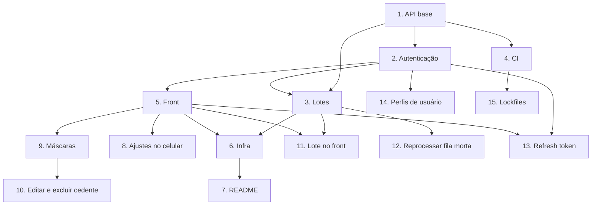

# Implementation Plan

## Overview

Tarefas da spec do Aprova-me. Cada tarefa aponta os critérios de [requirements.md](requirements.md) que atende; o desenho está em [design.md](design.md). As tarefas 1 a 9 estão entregues, na ordem dos commits; as de 10 a 15 são o backlog.

## Tasks

### Entregue

- [x] 1. API: validação, persistência e testes (níveis 1 a 3 do back-end)
  - Postgres + Prisma, migração inicial, CRUD de recebíveis e cedentes
  - Recebível com cedente na mesma transação; idempotência pelo id do cliente
  - `DECIMAL(15,2)` com texto no JSON; datas sem hora; CPF e CNPJ (inclusive alfanumérico) com dígitos verificadores
  - `ValidationPipe` com erros achatados por campo; filtro de erros do Prisma
  - Testes unitários de services, controllers e DTOs
  - _Requirements: 3.1, 3.2, 3.3, 3.4, 4.1, 4.2, 4.3, 4.4, 4.5, 4.6, 4.7, 5.1, 5.2, 5.3, 5.4, 5.5, 5.6, 5.7_

- [x] 2. API: autenticação e permissões (níveis 4 e 5)
  - `POST /integrations/auth` com JWT de 60 s e limite de 10 tentativas/min
  - `JwtAuthGuard` global com `@Public()` para as exceções
  - Usuários no banco com bcrypt; seed idempotente do `aprovame`
  - _Requirements: 1.1, 1.2, 1.3, 1.4, 2.1, 2.2, 2.3, 2.4_

- [x] 3. API: lotes assíncronos, retentativa e fila morta (níveis 7 e 8)
  - Worker separado (`worker.ts`) consumindo a fila `payables`, um job por recebível
  - `BatchItem` com chave composta; fechamento do lote por `UPDATE` condicional
  - Erro temporário retenta com backoff; permanente vai direto para a fila morta
  - E-mails pela fila `notifications`; Mailpit no ambiente local
  - _Requirements: 6.1, 6.2, 6.3, 6.4, 6.5, 6.6, 7.1, 7.2, 7.3, 7.4_

- [x] 4. CI com lint, testes unitários, e2e e build das imagens
  - _Requirements: 12.3_

- [x] 5. Front: Next 16, níveis 1 a 5
  - Login com cookie httpOnly, `proxy.ts`, contador de sessão
  - Cadastro de recebível com validação em três camadas, valor em pt-BR e combobox de cedentes
  - Listagem paginada, detalhe, edição e exclusão de recebíveis
  - Listagem, detalhe e cadastro de cedente
  - Testes com Vitest + Testing Library
  - _Requirements: 8.1, 8.2, 8.3, 8.4, 9.1, 9.2, 9.3, 9.4, 9.5, 10.1, 11.1, 11.2_

- [x] 6. Infra: Docker Compose, deploy na AWS e Terraform (níveis 6, 9 e 10)
  - _Requirements: 12.1, 12.2, 12.4, 12.5_

- [x] 7. README com como rodar, decisões técnicas, capturas de tela e métricas
  - Workflow `screenshots.yml` gera as capturas com Playwright na branch `docs-assets`
  - _Requirements: 12.2_

- [x] 8. Front: ajustes para celular e erro que some ao corrigir o campo
  - _Requirements: 9.6, 11.1_

- [x] 9. Front: máscara de CPF/CNPJ e telefone no cadastro de cedente
  - `lib/mask.ts` com cursor preservado e backspace sobre a pontuação
  - _Requirements: 10.2, 10.3, 10.4_

### Backlog

Lacunas conhecidas, em ordem sugerida. Nenhuma foi começada.

- [ ] 10. Front: editar e excluir cedente
  - A API já tem `PATCH` e `DELETE /integrations/assignor/:id`; falta a tela
  - Reaproveitar `AssignorForm` com as máscaras; excluir com `DeleteButton` e tratar o 409 de cedente com recebíveis
  - _Requirements: 4.1, 4.6 (escrever o critério de front em 10.x antes)_

- [ ] 11. Front: enviar lote e acompanhar o andamento
  - Upload de CSV ou JSON, chamada a `POST /integrations/payable/batch`, tela com `GET .../batch/:id` atualizando até `COMPLETED`
  - _Requirements: 6.1, 6.4 (escrever o critério de front antes)_

- [ ] 12. API: reprocessar itens da fila morta
  - Hoje os itens ficam guardados, mas o reprocessamento é manual, pelo Redis
  - Rota autenticada para reenfileirar um item ou um lote; manter o id determinístico do job
  - _Requirements: escrever (relacionado a 7.3)_

- [ ] 13. Refresh token
  - O token de 60 s é exigência do enunciado; o refresh evita o login a cada minuto sem relaxar isso
  - _Requirements: escrever (relacionado a 1.1 e 8.4)_

- [ ] 14. Perfis de usuário
  - Hoje qualquer usuário autenticado cria e remove usuários
  - _Requirements: escrever (relacionado a 2.2)_

- [ ] 15. Versionar os `package-lock.json`
  - Sem eles o CI e os Dockerfiles caem no `npm install` e os builds não são reproduzíveis
  - Os dois já usam `npm ci` quando o lockfile existe; basta gerar com Node 22 e commitar
  - _Requirements: 12.3_

## Notes

- Faça **uma tarefa por vez** e marque `[x]` no mesmo commit que a entrega.
- Tarefa do backlog sem requisito: escreva o requisito em `requirements.md` antes de começar.
- Pronto quer dizer lint, checagem de tipos e testes passando no pacote alterado (veja o `AGENTS.md`).
- Tarefa nova entra no fim, com o próximo número; não renumere as existentes.

## Task Dependency Graph

