<p align="center">
  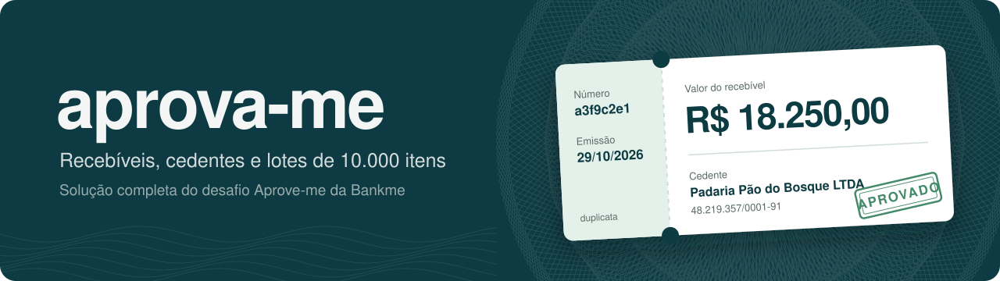
</p>

<p align="center">
  <a href="https://github.com/alluke96/aprova-me/actions/workflows/ci.yml"></a>
  
  
  
  
  
  
  
</p>

<table align="center">
  <tr>
    <td align="center"><b>15 de 15</b><br><sub>níveis do desafio</sub></td>
    <td align="center"><b>190 testes</b><br><sub>unitários e ponta a ponta</sub></td>
    <td align="center"><b>2.000 recebíveis em menos de 5 s</b><br><sub>lote processado no CI</sub></td>
    <td align="center"><b>1 comando</b><br><sub>para subir tudo</sub></td>
  </tr>
</table>

Solução completa do [desafio Aprove-me da Bankme](https://github.com/ReginaSobral/aprove-me): uma API de recebíveis e cedentes em **NestJS**, um front em **Next.js 16** e o processamento assíncrono de lotes de até 10.000 recebíveis, com retentativa, fila morta e e-mails. Todos os 10 níveis do back-end e os 5 do front-end estão implementados.

## 🚀 Rodando

```bash
docker compose up --build
```

| O quê | Onde |
| --- | --- |
| Front | http://localhost:3000 (login `aprovame`, senha `aprovame`) |
| API + Swagger | http://localhost:3001/docs |
| Caixa de e-mails (Mailpit) | http://localhost:8025 |

Sobem juntos o Postgres, o Redis, o Mailpit, a API, o worker de lotes e o front. A API aplica as migrações e cria o usuário padrão sozinha.

## 📸 Telas

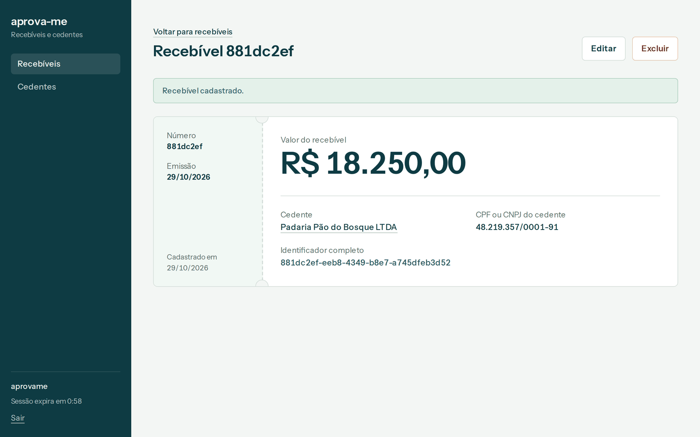
<p align="center"><sub>A ficha do recebível imita uma duplicata: canhoto com número e emissão, valor em destaque e link para o cedente.</sub></p>

<table>
  <tr>
    <td width="50%">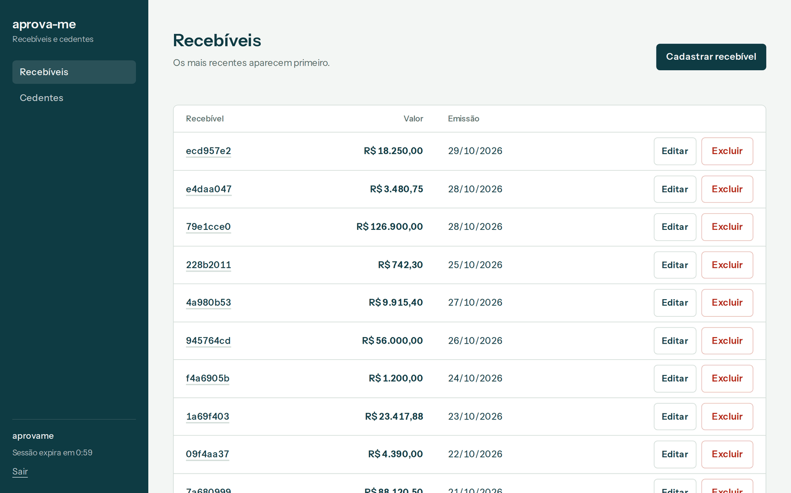<br><sub><b>Recebíveis.</b> Lista paginada com valor e emissão, mais recentes primeiro.</sub></td>
    <td width="50%">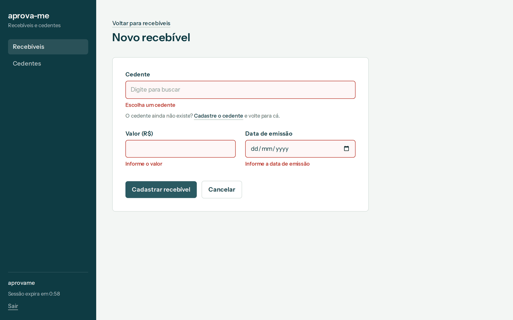<br><sub><b>Validação.</b> Nada vazio ou fora das regras chega à API.</sub></td>
  </tr>
  <tr>
    <td>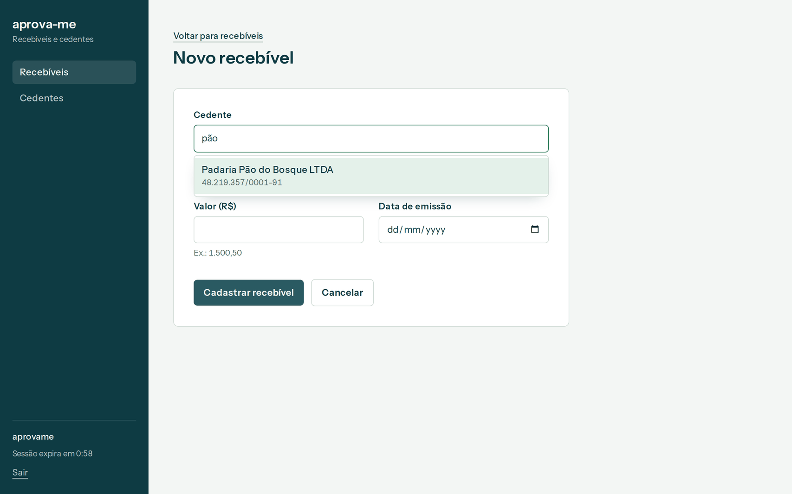<br><sub><b>Combobox.</b> Busca o cedente pelo nome ou pelo CPF/CNPJ, sem se importar com acento.</sub></td>
    <td>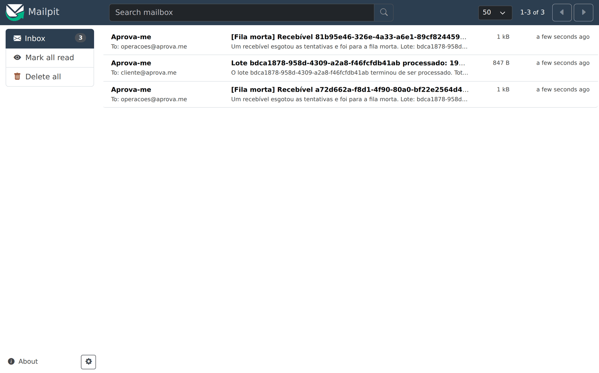<br><sub><b>E-mails.</b> Relatório do lote para o cliente e alerta de fila morta para operações.</sub></td>
  </tr>
</table>

<details>
<summary>Mais telas: Swagger, login, cedente, e-mail do lote e celular</summary>
<br>
<table>
  <tr>
    <td width="50%">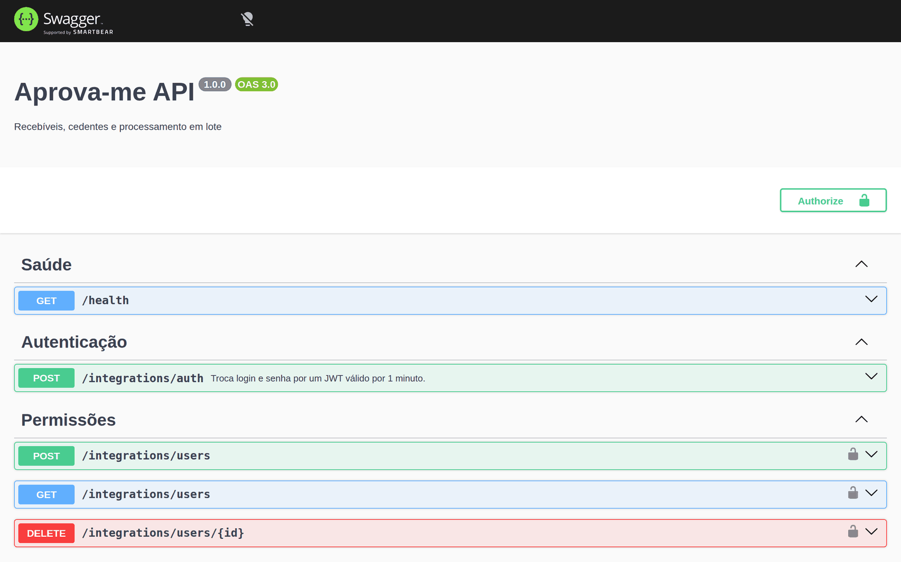<br><sub><b>Swagger</b> em <code>/docs</code>.</sub></td>
    <td width="50%">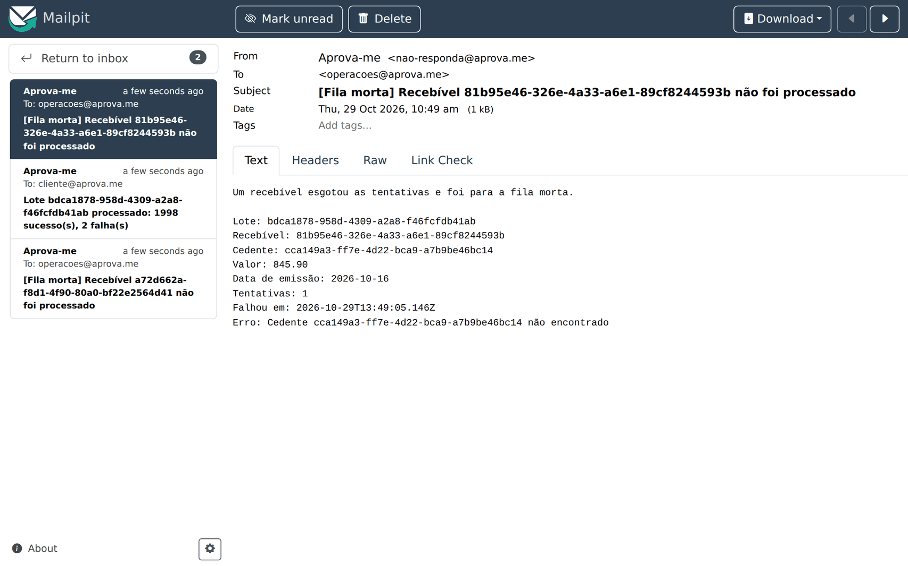<br><sub><b>E-mail do lote</b> com sucessos e falhas.</sub></td>
  </tr>
  <tr>
    <td>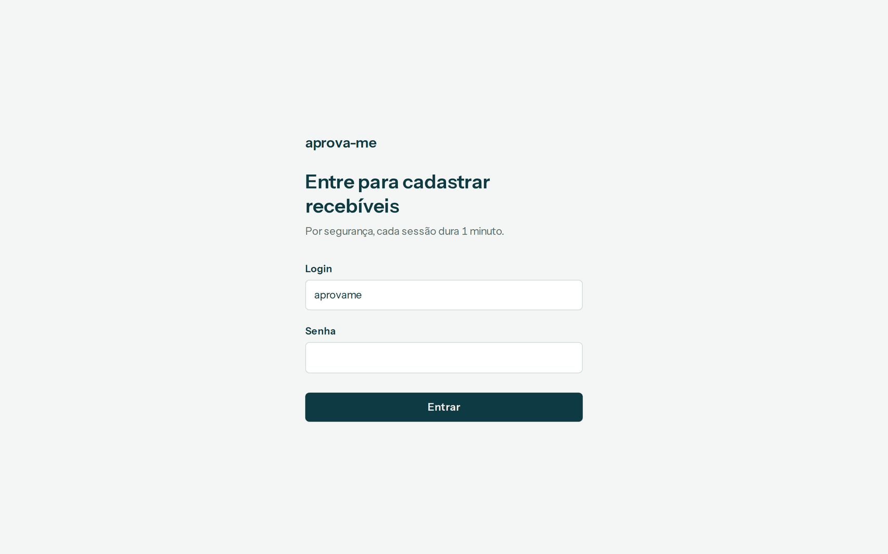<br><sub><b>Login.</b> Cada sessão dura 1 minuto, como pede o enunciado.</sub></td>
    <td>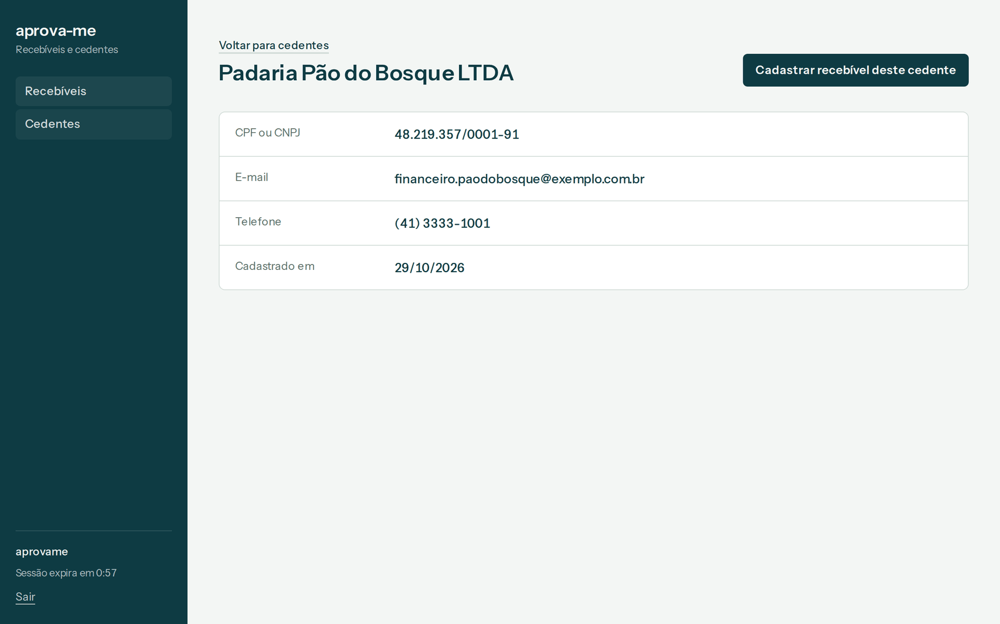<br><sub><b>Cedente</b>, com atalho para cadastrar um recebível dele.</sub></td>
  </tr>
</table>
<p align="center">
  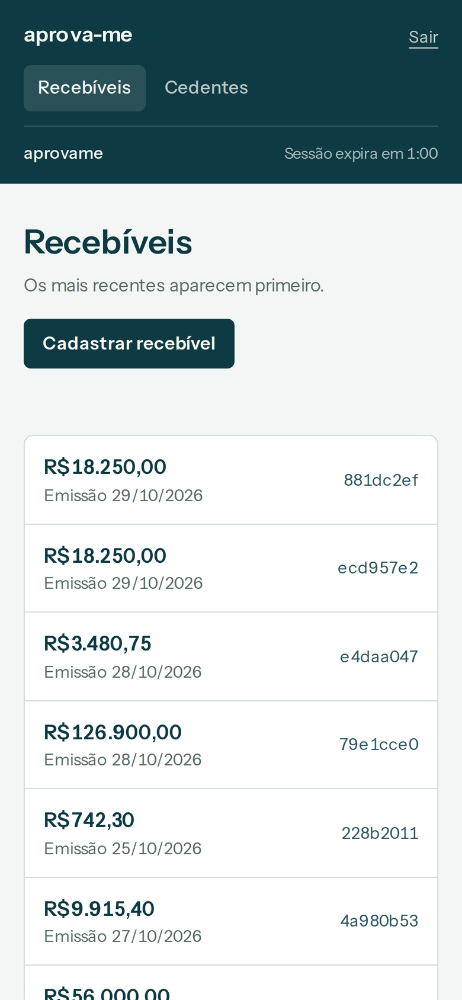
  &nbsp;&nbsp;
  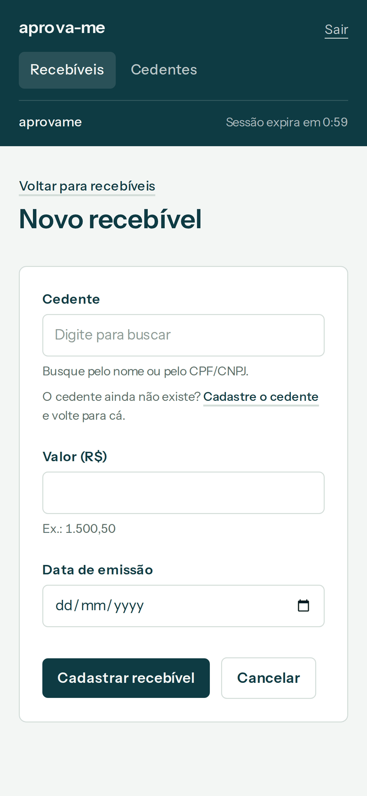
</p>
</details>

As capturas são geradas pelo workflow [`screenshots.yml`](.github/workflows/screenshots.yml): ele sobe o `docker compose`, cadastra dados de exemplo pela API (inclusive um lote de 2.000 recebíveis com 2 que vão para a fila morta), usa o front com o Playwright e mede os testes. Nenhuma tela foi montada à mão.

## 🧭 Arquitetura

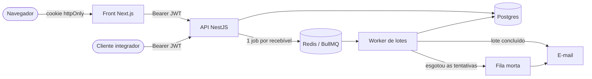

A API e o worker são o mesmo código com dois pontos de entrada (`main.ts` e `worker.ts`). O processamento de lotes escala separado das requisições, e um lote de 10.000 itens não deixa a API lenta.

### Como um lote anda

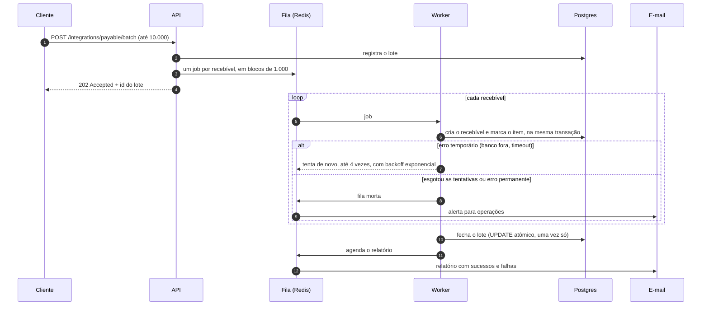

O cliente acompanha o progresso em `GET /integrations/payable/batch/:id`, que mostra quantos itens deram certo, quantos falharam e por quê.

## 🧠 Decisões técnicas

Onde mudei o que o enunciado pedia, foi de propósito:

| Enunciado | Escolha | Por quê |
| --- | --- | --- |
| SQLite | **Postgres** | É o banco que a Bankme usa em produção, e o processamento concorrente de lotes precisa de um banco que aguente escrita paralela. |
| `value` como `float` | **`DECIMAL(15,2)`** no banco, texto no JSON | `0.1 + 0.2` não é `0.3` em float. Em dinheiro, centavo perdido é erro. A API aceita `1500.5` ou `"1500.50"` e responde sempre `"1500.50"`. Número que já chega com erro de float é recusado, não arredondado. |
| Token no `localStorage` | **Cookie httpOnly** | Qualquer script na página lê o `localStorage`; um XSS roubaria o token. O cookie httpOnly é invisível ao JavaScript, e o front chama a API pelo servidor do Next. |
| Fila (não especificada) | **BullMQ + Redis** | Integração nativa com o Nest, retentativa com backoff e filas separadas para a fila morta e os e-mails. |
| `assignor` como `int` | **UUID** | O próprio enunciado pede ids UUID; mantive o mesmo tipo nos dois lados da relação. |

E as que não estavam no enunciado, mas fazem diferença numa fintech:

- **Idempotência pelo id do cliente.** Reenviar o mesmo recebível (retry de rede, clique duplo) devolve o existente em vez de duplicar; o mesmo id com outros dados responde 409. O front gera o id quando a tela abre, então dois cliques em "Cadastrar" não criam dois registros.
- **Cada item do lote é contado uma vez só.** O resultado de cada item vai para `batch_items` (chave lote + recebível) com `ON CONFLICT DO NOTHING`, na mesma transação que cria o recebível. Se o worker cair no meio e o job rodar de novo, os contadores não ficam errados. O lote fecha com um `UPDATE` condicional atômico, então o e-mail de conclusão sai uma vez, mesmo com vários workers.
- **Erro permanente não é retentado.** Banco fora do ar ganha 1 tentativa + 4 retentativas com backoff exponencial, como pede o nível 8. Cedente inexistente ou id em conflito vão direto para a fila morta: tentar de novo não mudaria nada.
- **E-mails passam por uma fila própria.** Se o SMTP estiver fora, o e-mail é retentado sem travar o processamento dos recebíveis.
- **CPF e CNPJ validados de verdade**, com dígitos verificadores, incluindo o CNPJ alfanumérico que a Receita adotou em julho de 2026.
- **Regra de negócio também no banco.** Um `CHECK` impede recebível com valor zero ou negativo, e a chave estrangeira impede excluir cedente que ainda tem recebíveis.
- **Sessão de 1 minuto sem susto.** O token dura o que o enunciado pede. Como é curto para quem usa a tela, o front mostra quanto falta e leva ao login quando acaba. Em produção, o próximo passo seria um refresh token.
- **Validação em três camadas.** O navegador barra o envio, a Server Action valida de novo e a API valida uma terceira vez. Os erros voltam por campo (`payable.value`, `assignor.email`) e aparecem embaixo de cada campo.

## ✅ Níveis entregues

<table>
<tr><th>Back-end</th><th>Front-end</th></tr>
<tr><td valign="top">

- [x] **1. Validação:** `POST /integrations/payable` com recebível e cedente, erros por campo
- [x] **2. Persistência:** Prisma + Postgres; consulta, edição e exclusão de recebíveis e cedentes
- [x] **3. Testes:** unitários de services, controllers, DTOs, guards e processors
- [x] **4. Autenticação:** `POST /integrations/auth` gera JWT de 1 minuto para todas as rotas
- [x] **5. Permissões:** usuários no banco com senha bcrypt
- [x] **6. Infra e doc:** `Dockerfile`s, `docker-compose.yml`, Swagger e este README
- [x] **7. Lotes:** até 10.000 itens por fila, com e-mail de sucessos e falhas
- [x] **8. Resiliência:** 4 retentativas, fila morta e e-mail para operações
- [x] **9. Cloud:** deploy contínuo no AWS ECS Fargate
- [x] **10. IaC:** Terraform com VPC, ALB, ECS, RDS, ElastiCache e Secrets Manager

</td><td valign="top">

- [x] **1. Cadastro:** formulário que bloqueia campos vazios e fora das regras
- [x] **2. API:** cadastro integrado, tela de cedente e combobox
- [x] **3. Listagem:** lista paginada, detalhes, edição, exclusão e link para o cedente
- [x] **4. Autenticação:** login com cookie httpOnly e volta ao login quando o token expira
- [x] **5. Testes:** Vitest + Testing Library nos formulários, combobox, sessão e cliente da API

</td></tr>
</table>

## 🔌 Usando a API

<details>
<summary>Exemplos com <code>curl</code></summary>

```bash
# 1. Token (vale 1 minuto)
TOKEN=$(curl -s -X POST localhost:3001/integrations/auth \
  -H 'Content-Type: application/json' \
  -d '{"login":"aprovame","password":"aprovame"}' | jq -r .access_token)

# 2. Recebível + cedente
curl -X POST localhost:3001/integrations/payable \
  -H "Authorization: Bearer $TOKEN" -H 'Content-Type: application/json' \
  -d '{
    "payable": {
      "id": "b3d4c5e6-7f80-4a1b-9c2d-3e4f5a6b7c8d",
      "value": "1500.50",
      "emissionDate": "2026-10-28",
      "assignor": "6f1c2a7e-2f7a-4b8e-9c55-0f6a3b9e1d10"
    },
    "assignor": {
      "id": "6f1c2a7e-2f7a-4b8e-9c55-0f6a3b9e1d10",
      "document": "11.222.333/0001-81",
      "email": "contato@empresa.com",
      "phone": "(41) 3333-0000",
      "name": "Empresa Cedente LTDA"
    }
  }'

# 3. Lote (até 10.000 recebíveis de cedentes já cadastrados)
curl -X POST localhost:3001/integrations/payable/batch \
  -H "Authorization: Bearer $TOKEN" -H 'Content-Type: application/json' \
  -d '{"payables":[{"id":"…","value":"10.00","emissionDate":"2026-10-28","assignor":"6f1c2a7e-2f7a-4b8e-9c55-0f6a3b9e1d10"}]}'

# 4. Acompanhar o lote
curl localhost:3001/integrations/payable/batch/<id-do-lote> -H "Authorization: Bearer $TOKEN"
```

Um erro de validação responde assim:

```json
{
  "statusCode": 400,
  "message": "Dados inválidos",
  "errors": [
    { "field": "payable.value", "messages": ["value deve ser um valor positivo com até 2 casas decimais"] },
    { "field": "assignor.email", "messages": ["email deve ser um e-mail válido"] }
  ]
}
```

</details>

| Rota | O que faz |
| --- | --- |
| `POST /integrations/auth` | Troca login e senha por um JWT de 1 minuto |
| `POST /integrations/payable` | Cadastra recebível (e o cedente, se enviado) |
| `GET, PATCH, DELETE /integrations/payable/:id` | Consulta, edita e exclui um recebível |
| `GET /integrations/payable` | Lista recebíveis, paginado |
| `POST /integrations/payable/batch` | Recebe um lote de até 10.000 recebíveis |
| `GET /integrations/payable/batch/:id` | Progresso e falhas do lote |
| `POST, GET /integrations/assignor` e `/:id` | Cadastro, consulta, edição e exclusão de cedentes |
| `POST, GET, DELETE /integrations/users` | Quem pode gerar tokens |

## 🧪 Testes

| Parte | Testes | Ferramentas |
| --- | --- | --- |
| API, unitários | 131 (cobertura de 96% das linhas) | Jest |
| API, ponta a ponta | 9 cenários com Postgres e Redis reais | Jest + Supertest |
| Front | 50 | Vitest + Testing Library |

```bash
cd backend && npm test          # unitários
cd backend && npm run test:e2e  # ponta a ponta, precisa de Postgres e Redis
cd frontend && npm test
```

O teste ponta a ponta sobe a API e o worker juntos e percorre o fluxo inteiro: autenticação, validação, cadastro idempotente, edição, exclusão e um lote com um item que vai para a fila morta, conferindo os dois e-mails. O CI ([`ci.yml`](.github/workflows/ci.yml)) roda lint, checagem de tipos, testes, build das imagens Docker e validação do Terraform a cada push.

## ☁️ Deploy na AWS

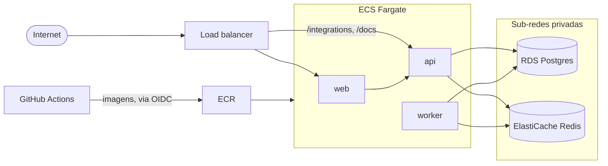

1. `cd infra/terraform && cp terraform.tfvars.example terraform.tfvars`, ajuste os valores e rode `terraform init` (com o backend S3) e `terraform apply`.
2. No GitHub, crie o segredo `AWS_DEPLOY_ROLE_ARN` com a saída `github_deploy_role_arn` e a variável `AWS_DEPLOY_ENABLED=true`.
3. A cada push na `main` com CI verde, o [workflow de deploy](.github/workflows/deploy.yml) publica as imagens no ECR e atualiza API, worker e front, nessa ordem. A API aplica as migrações ao subir, e o ECS desfaz o deploy sozinho se o serviço não ficar saudável.

Banco e Redis ficam em sub-redes privadas, os segredos no Secrets Manager e o Redis com `maxmemory-policy noeviction`, que o BullMQ exige para não perder jobs.

<details>
<summary>Rodando sem Docker</summary>

Requisitos: Node 22, Postgres e Redis (dá para subir só os dois com `docker compose up postgres redis mailpit`).

```bash
# API
cd backend
cp .env.example .env
npm install
npx prisma migrate deploy
npm run db:seed:dev
npm run start:dev           # API em :3001
npm run start:worker:dev    # worker, em outro terminal

# Front
cd frontend
cp .env.example .env.local
npm install
npm run dev                 # front em :3000
```

</details>

## 🗂️ Estrutura

```
backend/              API NestJS + worker
  prisma/             schema e migrações
  src/assignors       cedentes
  src/payables        recebíveis
  src/batches         lotes: API, worker, fila morta e e-mails
  src/auth, users     JWT e permissões
  test/               ponta a ponta
frontend/             Next.js 16 (App Router, Server Actions)
infra/terraform/      infraestrutura na AWS
scripts/screenshots/  gera as capturas deste README
.github/workflows/    CI, deploy e capturas
```

## 🤖 Como desenvolvi

Fiz este projeto com IA (Claude) como par de programação, que é como trabalho no dia a dia. As decisões da tabela de decisões técnicas foram minhas; a IA escreveu boa parte do código a partir delas, e o CI garantiu o resto, com lint, tipos, testes unitários e um teste ponta a ponta com Postgres e Redis reais a cada commit. Do repositório vazio ao CI verde com os 15 níveis foram cerca de 45 minutos. O histórico de commits segue os níveis do desafio.
