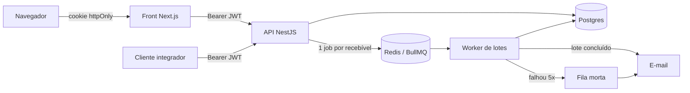

# Aprova-me

Solução completa do [desafio Aprove-me da Bankme](https://github.com/ReginaSobral/aprove-me): uma API de recebíveis e cedentes em **NestJS**, um front em **Next.js 16** e o processamento assíncrono de lotes de até 10.000 recebíveis. Os 10 níveis do back-end e os 5 do front-end estão implementados.

```bash
docker compose up --build
```

| O quê | Onde |
| --- | --- |
| Front | http://localhost:3000 (login `aprovame`, senha `aprovame`) |
| API + Swagger | http://localhost:3001/docs |
| Caixa de e-mails (Mailpit) | http://localhost:8025 |

## Arquitetura



A API e o worker são o mesmo código com dois pontos de entrada (`main.ts` e `worker.ts`). Assim o processamento de lotes escala separado das requisições, e um lote de 10.000 itens não deixa a API lenta.

## Decisões técnicas

Onde mudei o que o enunciado pedia, foi de propósito:

| Enunciado | Escolha | Por quê |
| --- | --- | --- |
| SQLite | **Postgres** | É o banco que a Bankme usa em produção, e o processamento concorrente de lotes precisa de um banco que aguente escrita paralela. |
| `value` como `float` | **`DECIMAL(15,2)`** no banco, texto no JSON | `0.1 + 0.2` não é `0.3` em float. Em dinheiro, centavo perdido é erro. A API aceita `1500.5` ou `"1500.50"` e responde sempre `"1500.50"`. Número que já chega com erro de float é recusado, não arredondado. |
| Token no `localStorage` | **Cookie httpOnly** | Qualquer script na página lê o `localStorage`; um XSS roubaria o token. O cookie httpOnly é invisível ao JavaScript e o front chama a API pelo servidor do Next. |
| Fila (não especificada) | **BullMQ + Redis** | Integração nativa com o Nest, retentativa com backoff e filas separadas para a fila morta e os e-mails. |
| `assignor` como `int` | **UUID** | O próprio enunciado pede ids UUID; mantive o mesmo tipo nos dois lados da relação. |

Outras decisões que valem a explicação:

- **Idempotência pelo id do cliente.** Os ids vêm de quem chama a API. Reenviar o mesmo recebível (retry de rede, clique duplo) devolve o existente em vez de duplicar; o mesmo id com outros dados responde 409. O front gera o id quando a tela abre, então dois cliques em "Cadastrar" não criam dois registros.
- **Cada item do lote é contado uma vez só.** O resultado de cada item vai para `batch_items` (chave lote + recebível) com `ON CONFLICT DO NOTHING`, na mesma transação que cria o recebível. Se o worker cair no meio e o job rodar de novo, os contadores de sucesso e falha não ficam errados. O lote fecha com um `UPDATE` condicional atômico, então o e-mail de conclusão sai uma vez, mesmo com vários workers.
- **Erro permanente não é retentado.** Banco fora do ar ganha 1 tentativa + 4 retentativas com backoff exponencial, como pede o nível 8. Já cedente inexistente ou id em conflito vão direto para a fila morta: tentar de novo não mudaria nada.
- **E-mails passam por uma fila própria.** Se o SMTP estiver fora, o e-mail é retentado sem travar o processamento dos recebíveis.
- **CPF e CNPJ validados de verdade**, com dígitos verificadores, incluindo o CNPJ alfanumérico que a Receita adotou em julho de 2026.
- **Token de 1 minuto, como pede o enunciado.** Como isso é curto para quem usa a tela, o front mostra quanto falta para a sessão expirar e leva ao login quando ela acaba, sem deixar a pessoa perder o que digitou num clique que ia falhar. Em produção, o próximo passo seria um refresh token.
- **Validação em três camadas.** O navegador barra campos vazios ou fora das regras antes de enviar, a Server Action valida de novo e a API valida uma terceira vez. Os erros voltam por campo (`payable.value`, `assignor.email`) e aparecem embaixo de cada campo.

## O que cada nível entrega

### Back-end

| Nível | Entrega |
| --- | --- |
| 1. Validação | `POST /integrations/payable` com recebível e cedente, erros por campo |
| 2. Persistência | Prisma + Postgres; `GET`, `PATCH` e `DELETE` de recebíveis e cedentes |
| 3. Testes | Testes unitários de services, controllers, DTOs, guards e processors + e2e |
| 4. Autenticação | `POST /integrations/auth` gera JWT de 1 minuto; todas as outras rotas exigem o token |
| 5. Permissões | Usuários no banco com senha bcrypt (`/integrations/users`); seed cria `aprovame` |
| 6. Infra e doc | `Dockerfile`s, `docker-compose.yml`, Swagger e este README |
| 7. Lotes | `POST /integrations/payable/batch` aceita até 10.000 itens, responde 202 e processa em fila; e-mail com sucessos e falhas |
| 8. Resiliência | 4 retentativas com backoff, fila morta e e-mail para operações |
| 9. Cloud | Pipeline de deploy para AWS ECS Fargate (`.github/workflows/deploy.yml`) |
| 10. IaC | Terraform com VPC, ALB, ECS, RDS, ElastiCache, Secrets Manager e ECR (`infra/terraform`) |

### Front-end

| Nível | Entrega |
| --- | --- |
| 1. Cadastro | Formulário de recebível que bloqueia campos vazios e fora das regras; mostra o recebível na tela seguinte |
| 2. API | Cadastro integrado à API, tela de cedente e combobox com busca por nome ou documento |
| 3. Listagem | Lista paginada (id, valor, emissão), detalhes, edição, exclusão e link para o cedente |
| 4. Autenticação | Login, token em cookie httpOnly e redirecionamento ao login quando o token expira |
| 5. Testes | Vitest + Testing Library: formulários, combobox, sessão, cliente da API e formatação |

## Usando a API

```bash
# 1. Token (vale 1 minuto)
TOKEN=$(curl -s -X POST localhost:3001/integrations/auth \
  -H 'Content-Type: application/json' \
  -d '{"login":"aprovame","password":"aprovame"}' | jq -r .access_token)

# 2. Recebível + cedente
curl -X POST localhost:3001/integrations/payable \
  -H "Authorization: Bearer $TOKEN" -H 'Content-Type: application/json' \
  -d '{
    "payable": {
      "id": "b3d4c5e6-7f80-4a1b-9c2d-3e4f5a6b7c8d",
      "value": "1500.50",
      "emissionDate": "2026-10-28",
      "assignor": "6f1c2a7e-2f7a-4b8e-9c55-0f6a3b9e1d10"
    },
    "assignor": {
      "id": "6f1c2a7e-2f7a-4b8e-9c55-0f6a3b9e1d10",
      "document": "11.222.333/0001-81",
      "email": "contato@empresa.com",
      "phone": "(41) 3333-0000",
      "name": "Empresa Cedente LTDA"
    }
  }'

# 3. Lote (até 10.000 recebíveis de cedentes já cadastrados)
curl -X POST localhost:3001/integrations/payable/batch \
  -H "Authorization: Bearer $TOKEN" -H 'Content-Type: application/json' \
  -d '{"payables":[{"id":"…","value":"10.00","emissionDate":"2026-10-28","assignor":"6f1c2a7e-2f7a-4b8e-9c55-0f6a3b9e1d10"}]}'

# 4. Acompanhar o lote
curl localhost:3001/integrations/payable/batch/<id-do-lote> -H "Authorization: Bearer $TOKEN"
```

A documentação completa, com todos os campos, está no Swagger em `/docs`.

## Rodando sem Docker

Requisitos: Node 22, Postgres e Redis (dá para subir só os dois com `docker compose up postgres redis mailpit`).

```bash
# API
cd backend
cp .env.example .env
npm install
npx prisma migrate deploy
npm run db:seed:dev
npm run start:dev           # API em :3001
npm run start:worker:dev    # worker, em outro terminal

# Front
cd frontend
cp .env.example .env.local
npm install
npm run dev                 # front em :3000
```

## Testes

```bash
cd backend && npm test         # unitários
cd backend && npm run test:e2e # ponta a ponta, precisa de Postgres e Redis
cd frontend && npm test
```

O teste e2e sobe a API e o worker juntos e percorre o fluxo inteiro: autenticação, validação, cadastro idempotente, edição, exclusão e um lote com um item que vai para a fila morta, conferindo os dois e-mails. O CI (`.github/workflows/ci.yml`) roda lint, checagem de tipos, testes, build das imagens e validação do Terraform a cada push.

## Deploy na AWS

1. `cd infra/terraform && cp terraform.tfvars.example terraform.tfvars`, ajuste os valores e rode `terraform init` (com o backend S3) e `terraform apply`.
2. No GitHub, crie o segredo `AWS_DEPLOY_ROLE_ARN` com a saída `github_deploy_role_arn` e a variável `AWS_DEPLOY_ENABLED=true`.
3. A cada push na `main` com CI verde, o workflow de deploy publica as imagens no ECR e atualiza API, worker e front no ECS, nessa ordem. A API aplica as migrações ao subir.

## Estrutura

```
backend/            API NestJS + worker
  prisma/           schema e migrações
  src/assignors     cedentes
  src/payables      recebíveis
  src/batches       lotes: API, worker, fila morta e e-mails
  src/auth, users   JWT e permissões
  test/             e2e
frontend/           Next.js 16 (App Router, Server Actions)
infra/terraform/    infraestrutura AWS
.github/workflows/  CI e deploy
```

## Como desenvolvi

Fiz este projeto com IA (Claude) como par de programação, que é como trabalho no dia a dia. As decisões de arquitetura da tabela acima foram minhas; a IA escreveu boa parte do código a partir delas, e o CI garantiu o resto: lint, tipos, testes unitários e um e2e com Postgres e Redis reais a cada commit. O histórico de commits segue os níveis do desafio.
